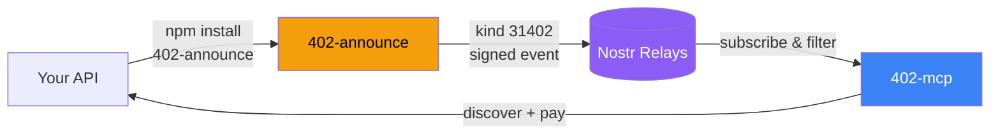
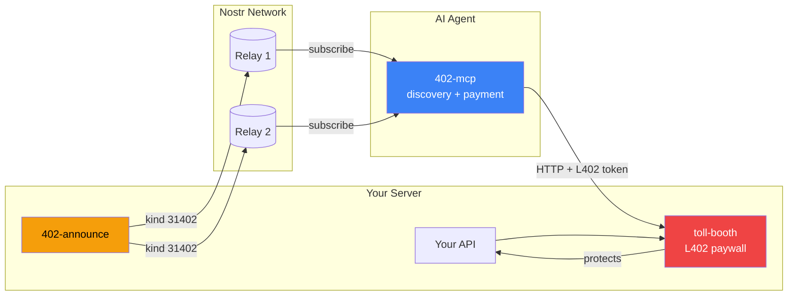
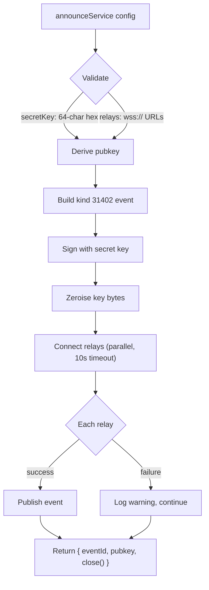
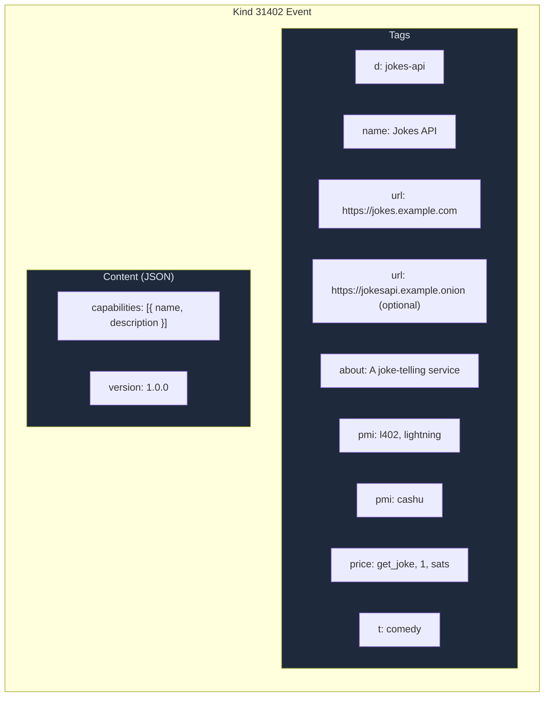

# 402-announce

Experimental storage discovery now has a separate, key-free API for public paid
packages and free mirror shelter. See the [version-1 contract](docs/storage-service-v1.md),
[JSON Schema](schemas/storage-service-v1.schema.json) and
[signed interoperability fixtures](fixtures/storage-v1/manifest.json).
`buildStorageAnnouncement` creates an unsigned event for an external signer;
`acceptSignedStorageAnnouncement` verifies the exact returned event, and
`selectStorageAnnouncements` preserves expired/withdrawn replacement records.
These APIs do not publish, contact storage nodes or purchase storage. The existing
paid-API `announceService` contract is unchanged.

**Nostr:** [`npub1mgvlrnf5hm9yf0n5mf9nqmvarhvxkc6remu5ec3vf8r0txqkuk7su0e7q2`](https://njump.me/npub1mgvlrnf5hm9yf0n5mf9nqmvarhvxkc6remu5ec3vf8r0txqkuk7su0e7q2)

Announce HTTP 402 services on Nostr for decentralised discovery. Supports both L402 and x402 payment protocols.

[](https://github.com/forgesworn/402-announce/actions/workflows/ci.yml)
[](./README.md)
[](./LICENSE)
[](https://github.com/sponsors/TheCryptoDonkey)

Publishes **kind 31402** parameterised replaceable events so that AI agents (and any Nostr client) can discover paid APIs without a central registry.

**[Live Dashboard](https://402.pub)** — see every service announcing on the network right now.

## How it works



Your API publishes a service announcement to Nostr relays. AI agents (via [402-mcp](https://github.com/forgesworn/402-mcp)) discover it, pay the invoice, and consume the API. No central registry required.

## Quick start

```bash
npm install 402-announce
```

402-announce is ESM-only. It ships no CommonJS build and its `exports` map has no `require` condition, so `require('402-announce')` fails with `ERR_PACKAGE_PATH_NOT_EXPORTED`. Use `import`, or `await import('402-announce')` from CommonJS.

```typescript
import { announceService } from '402-announce'

const handle = await announceService({
  secretKey: '64-char-hex-nostr-secret-key',
  relays: ['wss://relay.damus.io', 'wss://relay.primal.net'],
  identifier: 'jokes-api',
  name: 'Jokes API',
  urls: ['https://jokes.example.com'],
  about: 'A joke-telling service behind an L402 paywall',
  pricing: [
    { capability: 'get_joke', price: 1, currency: 'sats' },
  ],
  paymentMethods: [['l402', 'lightning'], ['cashu'], ['xcashu']],
  topics: ['comedy', 'ai'],
  capabilities: [
    { name: 'get_joke', description: 'Returns a random joke' },
  ],
  version: '1.0.0',
})

console.log('Published event:', handle.eventId)
console.log('From pubkey:', handle.pubkey)

// Later, when shutting down:
handle.close()
```

**Multi-transport example** (clearnet + Tor + Handshake — same service, different access paths):

```typescript
const handle = await announceService({
  secretKey: '64-char-hex-nostr-secret-key',
  relays: ['wss://relay.damus.io', 'wss://relay.primal.net'],
  identifier: 'jokes-api',
  name: 'Jokes API',
  urls: [
    'https://jokes.example.com',                  // clearnet
    'http://jokesxyz...onion',                    // Tor hidden service
    'https://jokes.example.hns',                  // Handshake domain
  ],
  about: 'A joke-telling service behind an L402 paywall',
  pricing: [{ capability: 'get_joke', price: 1, currency: 'sats' }],
  paymentMethods: [['l402', 'lightning']],
  topics: ['comedy', 'ai'],
})
```

Each URL becomes a separate `url` tag in the kind 31402 event. Clients try them in order and use whichever they can reach.

`urls` accepts 1–10 entries. Not every parseable URL is accepted: see [URL and relay validation](#url-and-relay-validation).

See the [`examples/`](https://github.com/forgesworn/402-announce/tree/main/examples) directory in the GitHub repository for runnable scripts. It is not included in the npm package.

## How it fits together



1. **[toll-booth](https://github.com/forgesworn/toll-booth)** wraps your API with an L402 paywall
2. **402-announce** publishes a kind 31402 event describing the service, pricing, and payment methods
3. **[402-mcp](https://github.com/forgesworn/402-mcp)** discovers the announcement, pays the invoice, and calls your API

## What it does

- Builds and signs kind 31402 Nostr events
- Publishes to one or more Nostr relays in parallel
- Zeroises secret key bytes after use
- Degrades gracefully when individual relays fail (if every relay fails it still resolves; see [`announceService`](#announceserviceconfig-promiseannouncement))
- Provides a `close()` handle for clean disconnection

## What it does not do

- Does not run an L402 paywall (use [toll-booth](https://github.com/forgesworn/toll-booth) for that)
- Does not subscribe to or search for announcements (use [402-mcp](https://github.com/forgesworn/402-mcp) for that)
- Does not handle payments or token verification

## API

### `announceService(config): Promise<Announcement>`

High-level function that builds, signs, and publishes the event to multiple relays.

**Returns** an `Announcement` handle:
- `eventId`: the ID of the signed Nostr event
- `pubkey`: the Nostr pubkey derived from your secret key
- `close()`: disconnect from all relays (synchronous; call it on shutdown to avoid leaking WebSockets)

**Rejects** (it is an `async` function, so these are promise rejections) when the config is invalid: a `secretKey` that is not 64 hex characters, an empty relay list, more than 50 relays, a relay URL that is not `ws://` or `wss://`, has credentials or points at a private or loopback host, a service `urls` list with no public URL, or any `buildAnnounceEvent` validation failure.

**Relay failures never reject.** Each relay is tried in parallel with a 10-second connect timeout, and a failure is logged with `console.warn`. If every relay fails, `announceService` still resolves with the `eventId` of the signed event, even though no relay accepted it, and logs `[402-announce] No relays accepted the event`. The `Announcement` handle does not report how many relays accepted the event, so the warning is the only signal. If you need to know that at least one relay stored the event, call `buildAnnounceEvent` and publish it yourself, checking each `relay.publish()` result.

### `buildAnnounceEvent(secretKey, config): VerifiedEvent`

Lower-level function that builds and signs the event without publishing. Useful if you manage relay connections yourself. `config` is an `AnnounceConfig` without `relays`. It throws synchronously on invalid input and does not apply the "at least one public URL" rule.

### `isPrivateHost(hostname): boolean`

The SSRF guard that `announceService` applies to relay and service URLs, exported for your own use. It takes a bare hostname (not a URL) and returns `true` for:

- `localhost`, `*.localhost`
- IPv6 `::1`, `::`, link-local `fe80::/10`, unique-local `fc00::/7`, Teredo `2001:0000::/32`, and IPv4-mapped, IPv4-compatible or 6to4 forms that embed a private IPv4 address
- IPv4 `0.0.0.0/8`, `10.0.0.0/8`, `100.64.0.0/10`, `127.0.0.0/8`, `169.254.0.0/16`, `172.16.0.0/12`, `192.0.0.0/24`, `192.0.2.0/24`, `192.88.99.0/24`, `192.168.0.0/16`, `198.18.0.0/15`, `198.51.100.0/24`, `203.0.113.0/24` and `240.0.0.0/4`
- octal, hexadecimal, single-integer and two- or three-part shorthand IPv4 spellings (for example `0x7f000001`, `2130706433`, `127.1`)

It inspects the string only and never resolves DNS. It does not flag multicast addresses such as `224.0.0.1`.

### Constants and types

- `L402_ANNOUNCE_KIND`: the event kind, `31402`
- `AnnounceConfig`, `Announcement`, `PricingDef`, `CapabilityDef`: type-only exports

```typescript
interface PricingDef {
  capability: string // 1-64 characters, no control characters
  price: number      // finite and non-negative
  currency: string   // any non-blank string up to 32 characters, no control characters
}

interface CapabilityDef {
  name: string         // up to 128 characters
  description: string  // up to 4096 characters
  endpoint?: string    // starts with '/', 'http://' or 'https://'; up to 2048 characters
  schema?: unknown     // JSON Schema for the input
  outputSchema?: unknown // JSON Schema for the output
}
```

`currency` is a free-form label, not an enumeration: the library does not check it against a list of allowed values, and `'sats'` is simply the value used throughout this documentation. Whether a client understands another unit is up to that client. `pricing` takes 1–100 entries and `capabilities` at most 100. The whole event content may be at most 64 KiB and 20 levels of nesting.

### Config options

| Field            | Type              | Required | Description                                    |
|------------------|-------------------|----------|------------------------------------------------|
| `secretKey`      | `string`          | yes      | 64-char hex Nostr secret key                   |
| `relays`         | `string[]`        | yes      | Relay URLs (`wss://` or `ws://`)               |
| `identifier`     | `string`          | yes      | Unique listing ID (Nostr `d` tag)              |
| `name`           | `string`          | yes      | Human-readable service name                    |
| `urls`           | `string[]`        | yes      | Transport endpoints for the service (1–10 unique entries, each up to 2048 characters; some schemes are denied and `announceService` needs one public URL, see [URL and relay validation](#url-and-relay-validation)) |
| `about`          | `string`          | yes      | Short description                              |
| `pricing`        | `PricingDef[]`    | yes      | Per-capability pricing                         |
| `paymentMethods` | `string[][]`      | yes      | Accepted payment methods (each entry is `[rail, ...params]`) |
| `picture`        | `string`          | no       | Icon URL                                       |
| `topics`         | `string[]`        | no       | Topic tags for filtering                       |
| `capabilities`   | `CapabilityDef[]` | no       | Capability details (stored in event content)   |
| `version`        | `string`          | no       | Service version (stored in event content)      |

### URL and relay validation

Both `buildAnnounceEvent` and `announceService` reject a `urls` entry that:

- is not parseable by `new URL()`, is longer than 2048 characters or contains control characters
- uses the scheme `data:`, `file:`, `javascript:`, `blob:` or `vbscript:`
- duplicates another entry

`buildAnnounceEvent` stops there and accepts private hosts, because it only serialises. `announceService` also requires at least one public URL: an `http:` or `https:` URL whose hostname `isPrivateHost` does not match, a `.onion` hostname, or any other scheme (the last two skip the host check). The remaining entries may be private.

Relay URLs are stricter: `ws://` or `wss://` only, no embedded credentials, no private or loopback host, and at most 50 after de-duplication. A `ws://` relay logs a warning.

These checks read the hostname text only. There is no DNS resolution, so DNS rebinding is not caught; deploy behind network-level egress controls.

## Storage announcement API

The storage extension described at the top of this README is key-free: it builds unsigned events, verifies events that an external signer returns, and selects between them. It does not publish, contact storage nodes or purchase storage, and it is separate from `announceService`. Do not pass a storage description to `announceService` or `buildAnnounceEvent`.

Import path. The six functions are exported from the `402-announce/storage` subpath and also from the package root:

```typescript
import { buildStorageAnnouncement } from '402-announce/storage'
// or: import { buildStorageAnnouncement } from '402-announce'
```

The subpath carries only the six functions and the `ParsedStorageAnnouncement` type. The constants (`STORAGE_PROFILE`, `STORAGE_SERVICE_PATH`, `STORAGE_MAX_EVENT_BYTES`, `STORAGE_MAX_TTL_SECONDS`, `STORAGE_DEFAULT_MAX_AGE_SECONDS`) and the description types (such as `StorageServiceDescription` and `StorageReadOptions`) are exported from the root only.

| Function | Signature | Purpose |
|----------|-----------|---------|
| `buildStorageAnnouncement` | `(value: unknown, createdAt?: number) => EventTemplate` | Validate a description and return an unsigned kind 31402 event for an external signer |
| `acceptSignedStorageAnnouncement` | `(value: unknown, requested: EventTemplate, options: StorageReadOptions) => ParsedStorageAnnouncement` | Verify the returned event and accept it only if it is current and identical to `requested` (same kind, `created_at`, tags and content) |
| `parseStorageAnnouncement` | `(value: unknown, options: StorageReadOptions) => ParsedStorageAnnouncement` | Verify a signed event and return it with its description and a `freshness` of `'current'`, `'stale'` or `'expired'` |
| `selectStorageAnnouncements` | `(values: readonly unknown[], options: StorageReadOptions) => ParsedStorageAnnouncement[]` | Keep the newest valid record per pubkey and `d` tag, including expired and withdrawn ones; invalid records are skipped |
| `validateStorageDescription` | `(value: unknown) => StorageServiceDescription` | Strictly validate and copy a public HTTP description |
| `validateStorageEndpointBinding` | `(value: unknown, announcement: ParsedStorageAnnouncement, selectedOrigin: string, options: StorageReadOptions) => StorageServiceDescription` | Check a freshly fetched description against the signed identity, listing and chosen origin |

`StorageReadOptions` is `{ now: number; maxAgeSeconds?: number; clockSkewSeconds?: number }`, with `now` in Unix seconds. The functions throw `Error('Invalid storage service profile.')` on invalid input. `selectStorageAnnouncements` skips invalid records instead, but still throws for invalid options or more than 512 records.

The flow is build, sign externally, accept, select, then bind to the endpoint. The example below uses a throwaway local key as the stand-in for the external signer (`nostr-tools` is a dependency of this package). In production the key never enters this code.

```typescript
import { finalizeEvent, generateSecretKey, getPublicKey } from 'nostr-tools/pure'
import {
  acceptSignedStorageAnnouncement,
  buildStorageAnnouncement,
  selectStorageAnnouncements,
  validateStorageEndpointBinding,
} from '402-announce/storage'

const now = Math.floor(Date.now() / 1000)
const signerKey = generateSecretKey() // stand-in for an external signer

const description = {
  profile: 'forgesworn-storage-service-v1',
  service_pubkey: getPublicKey(signerKey),
  identifier: 'open-shelter-node',
  name: 'Open shelter node',
  about: 'Best-effort mirror shelter for signed blobs.',
  origins: ['https://storage.example/'],
  max_blob_bytes: 1073741824,
  observed_at: now,
  expires_at: now + 7200,
  state: 'published',
  checkout: null,
  services: [{
    id: 'open-shelter',
    type: 'free-mirror',
    revision: 1,
    availability: 'accepting',
    operation: 'mirror',
    authorisation: 'bud-11',
    retention: 'best-effort',
    eviction_policy: 'Guest mirrors can be evicted under storage pressure.',
  }],
}

// 1. Build the unsigned event. No key or network access.
const requested = buildStorageAnnouncement(description)

// 2. Sign it externally. The signer must not change the template.
const signed = finalizeEvent(requested, signerKey)

// 3. Accept the returned event. Throws if the signature, freshness or template differ.
const accepted = acceptSignedStorageAnnouncement(signed, requested, { now })
// Publishing accepted.event to relays is a separate step that you perform.

// 4. Later, a reader selects the newest record per listing from relay results.
const listings = selectStorageAnnouncements([accepted.event], { now })
const [listing] = listings
// Keep `listings` as watermarks. Show only current, published, accepting services.

// 5. After separately fetching the node's description (GET /services/v1, here reusing
//    `description`), check it matches the signed listing and the chosen origin.
const fetched = description
const current = validateStorageEndpointBinding(fetched, listing, 'https://storage.example/', { now })
console.log(current.identifier)
```

Paid storage listings add a `checkout` object and `paid-storage` services. See the [version-1 contract](docs/storage-service-v1.md) for every field and the [signed fixtures](fixtures/storage-v1/manifest.json) for paid, combined, withdrawn and expired examples.

## Announce flow



## Event format

Each announcement is a **kind 31402** parameterised replaceable event. The combination of `pubkey` + `d` tag uniquely identifies a listing — publishing again with the same values updates the existing listing.



### Tags

| Tag       | Required | Description                                  | Example                           |
|-----------|----------|----------------------------------------------|-----------------------------------|
| `d`       | yes      | Unique identifier for this listing           | `jokes-api`                       |
| `name`    | yes      | Human-readable service name                  | `Jokes API`                       |
| `url`     | yes      | HTTP endpoint (one tag per URL; repeatable)  | `https://jokes.example.com`       |
| `about`   | yes      | Short description                            | `A joke-telling service`          |
| `pmi`     | yes      | Payment method identifier (repeatable, multi-element) | `l402`, `lightning`        |
| `price`   | yes      | Capability pricing (repeatable)              | `get_joke`, `1`, `sats`           |
| `t`       | no       | Topic tag for search/filtering (repeatable)  | `comedy`                          |
| `picture` | no       | Icon URL                                     | `https://example.com/icon.png`    |

### Recognised Payment Method Rails

Each `paymentMethods` entry is an array where the first element is the rail identifier and subsequent elements are rail-specific parameters.

| Rail | Example | Description |
|------|---------|-------------|
| `l402` | `['l402', 'lightning']` | L402 protocol (Lightning BOLT-11 invoices) |
| `cashu` | `['cashu']` | Cashu ecash (generic) |
| `xcashu` | `['xcashu']` | Cashu ecash via NUT-24 (X-Cashu header) |
| `lnurlcash` | `['lnurlcash', 'mint.example']` | LUD-25 bearer note presented in an X-LNURLcash header (subsequent elements are the accepted mint hosts) |
| `x402` | `['x402', 'base', 'usdc', '0xabc...']` | x402 stablecoin payments (chain, token, receiver address) |
| `payment` | `['payment', 'lightning']` | IETF Payment protocol |

### Content

The event content is a JSON object with optional fields. Each capability may also carry `endpoint`, `schema` and `outputSchema` (see `CapabilityDef` above):

```json
{
  "capabilities": [
    { "name": "get_joke", "description": "Returns a random joke", "endpoint": "/api/joke" }
  ],
  "version": "1.0.0"
}
```

## Multiple URLs vs multiple events

This distinction is important for operators:

**Multiple URLs in one event** — use `urls: ['...', '...']` when the URLs represent the **same service** on different transports (clearnet, Tor, Handshake). The pricing, credentials, and macaroon signing key are identical. Clients pick whichever URL they can reach. This is for censorship resistance and redundancy.

**Separate kind 31402 events** — publish a new event (different `identifier`) when you have **genuinely different services**: different pricing tiers per transport, different capabilities, or services that operate independently. A single event should describe one logical service.

In short: same service + different network paths → one event with multiple `url` tags. Different services → separate events.

## Security

- Secret key bytes are zeroised immediately after signing (in both `announceService` and `buildAnnounceEvent`)
- Never log or persist the secret key — pass it in and let the library handle cleanup
- Relay connections use a 10-second timeout to prevent hanging
- Individual relay failures are logged as warnings but don't reject the promise. If every relay fails, `announceService` still resolves with the `eventId` of the signed event and logs `[402-announce] No relays accepted the event`
- Relay and service URLs are checked against private and loopback patterns (see [URL and relay validation](#url-and-relay-validation)); DNS rebinding is not caught

## Ecosystem

| Package | Purpose |
|---------|---------|
| [toll-booth](https://github.com/forgesworn/toll-booth) | L402 middleware — any API becomes a toll booth in minutes |
| [toll-booth-announce](https://github.com/forgesworn/toll-booth-announce) | Bridge — announce toll-booth services with one function call |
| [satgate](https://github.com/forgesworn/satsgate) | Production L402 gateway with Lightning and Cashu support |
| [402-mcp](https://github.com/forgesworn/402-mcp) | MCP server for AI agents to discover, pay, and consume 402 APIs |
| [Live Dashboard](https://402.pub) | See every service announcing on the network |

## Part of the ForgeSworn Toolkit

[ForgeSworn](https://forgesworn.dev) builds open-source cryptographic identity, payments, and coordination tools for Nostr.

| Library | What it does |
|---------|-------------|
| [nsec-tree](https://github.com/forgesworn/nsec-tree) | Deterministic sub-identity derivation |
| [ring-sig](https://github.com/forgesworn/ring-sig) | SAG/LSAG ring signatures on secp256k1 |
| [range-proof](https://github.com/forgesworn/range-proof) | Pedersen commitment range proofs |
| [canary-kit](https://github.com/forgesworn/canary-kit) | Coercion-resistant spoken verification |
| [spoken-token](https://github.com/forgesworn/spoken-token) | Human-speakable verification tokens |
| [toll-booth](https://github.com/forgesworn/toll-booth) | L402 payment middleware |
| [geohash-kit](https://github.com/forgesworn/geohash-kit) | Geohash toolkit with polygon coverage |
| [nostr-attestations](https://github.com/forgesworn/nostr-attestations) | NIP-VA verifiable attestations |
| [dominion](https://github.com/forgesworn/dominion) | Epoch-based encrypted access control |
| [nostr-veil](https://github.com/forgesworn/nostr-veil) | Privacy-preserving Web of Trust |

## Licence

[MIT](./LICENSE)
